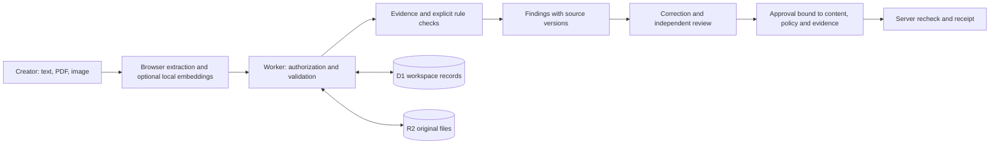

# Proofline

**Evidence before approval.** A working brand-review desk by **Hail Mary**, built for Round 2 of the We Code Coders hackathon against the Inkloom AI brief.

## Judge walkthrough

1. Open the project and choose **Try the sample workspace**. No account or API key is required.
2. Run a review of the sample draft. Inspect the 30% claim against the source's qualified 18% result.
3. Apply all three corrections and choose **Save & review**.
4. Request approval. Change the demo role to **Reviewer · Morgan**, inspect the evidence and approve.
5. Export the receipt. Return to Creator, revise and save the content: the previous approval becomes outdated and export is blocked.
6. Explore the evidence library, brand rules, discussion and activity record. Use Brand owner · Jordan to edit a policy or evidence source and see existing reviews become outdated.

Demo roles are explicitly simulated for evaluation. Signed-in private workspaces use server-enforced membership; a different member must approve a creator's draft.

## Run locally

Requirements: Node.js 24 recommended (22.13+ supported), npm and Git. No model API key is needed.

```sh
npm ci
node scripts/copy-assets.mjs
npm run build
node --import ./scripts/sites-env.mjs ./node_modules/wrangler/bin/wrangler.js d1 execute DB --local --config dist/server/wrangler.json --persist-to .wrangler/state --file drizzle/0000_long_night_nurse.sql
npm run dev
```

Use the URL printed by the server. Apply the migration once to a fresh local database. Development uses the starter's local sign-in simulation; production relies on the Sites authentication gateway. Do not expose the development server as a production service or trust client-supplied identity headers outside that gateway.

```sh
npm test
npm run typecheck
# With local preview running:
npm run test:http
```

`npm start` previews the built Worker on loopback. The Sites manifest declares D1 (`DB`) and R2 (`BUCKET`); supported publication provisions hosted storage and applies migrations. See [starter deployment notes](docs/STARTER.md).

## Architecture



- React/TypeScript and Vinext power the interface and server routes.
- D1 holds versioned workspace state and roles; R2 holds original uploads.
- PDF.js, Tesseract.js and Transformers.js run extraction/embedding in the browser.
- MiniLM helps rank evidence. Explicit rules compare figures and scope; the model never approves content.
- SHA-256 fingerprints, source digests and policy versions invalidate stale approvals. Compare-and-swap writes prevent silent concurrent overwrites.

## Scope and limits

English text up to 1,000 words, digital PDFs up to five pages, PNG/JPEG up to 10 MB. Workspace limits: 30 drafts, 50 sources, 12 files / 40 MB. Scanned PDF text needs manual transcription and confirmation. Image OCR can miss or misread text. Colour checks use user-supplied values, not pixel sampling. The claim detector covers recognised numerical units and broad-promise terms, not all factual language. Local model downloads depend on external hosts. A clean result is not factual, legal or accessibility certification.

## Submission documentation

- [Round 2: features, implementation, changes and three Round 3 improvements](docs/ROUND_2.md)
- [Third-party components and AI disclosure](THIRD_PARTY.md)
- [Team contribution log](docs/CONTRIBUTIONS.md)

The six participants are Premnath V R, Mirthika S, Rithikha B, Kanish S, Bharathraj Nagarajan and dharshini T, from Bannari Amman Institute of Technology, third-year Computer Science and Business Systems. Roles are assigned ownership, not a claim that each person authored a particular commit. Codex assisted the implementation, tests and documentation.
